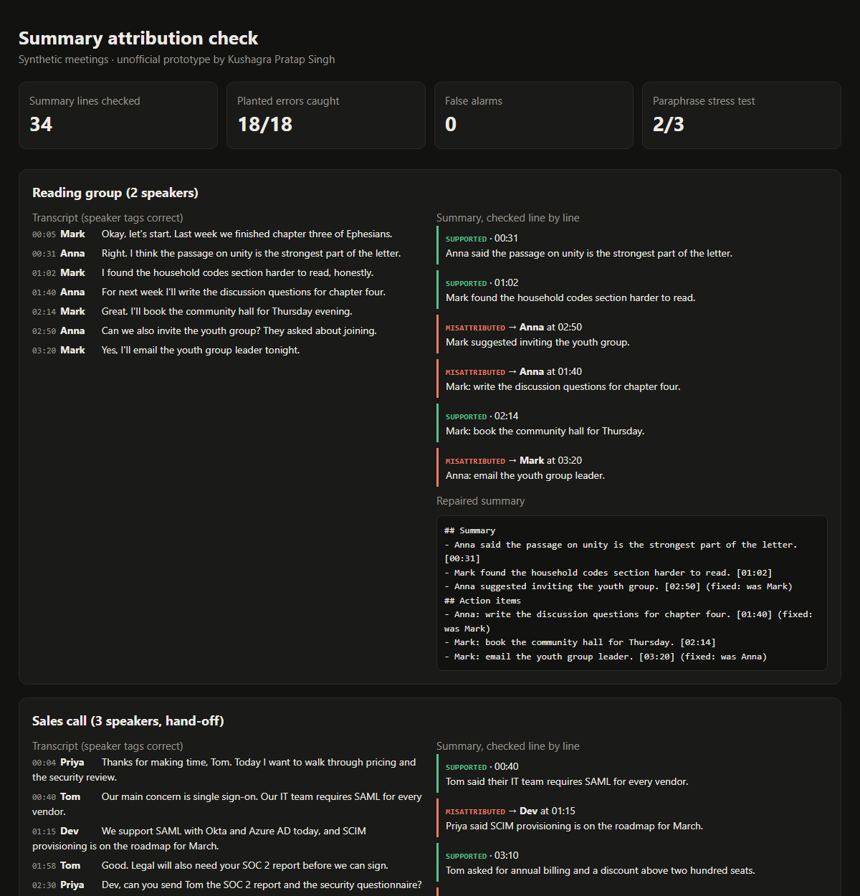

# Summary Attribution Check

> Unofficial prototype by Kushagra Pratap Singh. Not affiliated with Pocket.

## The problem

On Pocket's community forum, a thread is titled **"Speaker identification: Transcript is correct, Summary is not"** ([link](https://community.heypocket.com/t/speaker-identification-transcript-is-correct-summary-is-not/608)). The user fixed every speaker tag and regenerated, and the summary still credited the wrong person. Other threads report the same thing in other forms: a name from one recording showing up in another ([link](https://community.heypocket.com/t/more-speaker-recognition-issues/630)), and "assigns multiple speakers when there's only two" ([link](https://community.heypocket.com/t/underwhelmed-a-little-buyers-remorse/864)).

Two things make this costly. Speaker detection is a Pro feature, and action items flow into Linear, Asana and ClickUp. A wrong name in the summary therefore becomes a task assigned to the wrong person in another tool.

## What I built

A post-check that runs **after** the summary is generated and before the user sees it. The transcript is right; the job is to make sure the summary agrees with it.



For every summary line that names a person, the checker:

1. **Parses the claim.** It finds who is named and whether the line is a statement ("Tom said…") or a commitment ("Dev: send the report"). It also handles "Priya asked Dev to…".
2. **Finds the evidence.** It looks for the transcript lines that cover the claim's content words. First person counts as the speaker ("I'll send it" means the speaker will send it).
3. **Resolves hand-offs.** In *"Dev, can you send Tom the SOC 2 report?"* → *"Sure"*, the task belongs to **Dev**. Priya said the words, Tom is only mentioned, and a declined request doesn't count.
4. **Gives a verdict.** Each line is **SUPPORTED**, **MISATTRIBUTED** (with the right person and timestamp), or **UNSUPPORTED** (nothing backs it, so it may be a hallucination). It also flags names that aren't speakers in this recording, which is the "John became Chris" leak.
5. **Repairs the summary.** It swaps in the right name and adds a `[mm:ss]` citation to every line.

```
== Sales call (3 speakers, hand-off)
 [  ok ] Tom said their IT team requires SAML for every vendor.
 [ FIX ] Priya said SCIM provisioning is on the roadmap for March. -> Dev @ 01:15
 [ FIX ] Priya: send Tom the SOC 2 report and security questionnaire by Wednesday. -> Dev @ 02:30
 [ FIX ] Dev: prepare an annual quote for two hundred and fifty seats. -> Priya @ 03:45
 [ ??? ] Dev: schedule a demo of SCIM for the IT team next week.

Benchmark (6 meetings, 34 summary lines, 18 planted errors): caught 18/18, false alarms 0
Paraphrase stress test: caught 2/3 with the right label
```

**Read these numbers honestly.** I wrote the 6 benchmark meetings myself. They cover 2–3 speakers, a phone call, hand-offs, a leaked name and hallucinated tasks, so 18/18 shows the logic works, not real-world accuracy. The separate **paraphrase stress test** shows the limit. "Contact the supplier regarding the delayed delivery" shares no words with "I'll ping the vendor about the late shipment", so the checker labels it UNSUPPORTED instead of MISATTRIBUTED. It is still flagged, not passed. A production version would swap the word-overlap scorer for embeddings or a small LLM judge; the hand-off and owner logic stays the same.

### Fixing it at the source too
`attribution_check/cited.py` holds a summary prompt that makes the model end every line with transcript ids (`[S4]`), plus a validator. The validator checks that the person named on each line said, or accepted, the line it cites, and flags missing, invalid or wrong citations. With `GROQ_API_KEY` set, `llm_summary()` generates a cited summary to validate (free tier works). Everything else runs offline.

| File | What |
|---|---|
| `attribution_check/core.py` | tokenizer, hand-off resolution, claim parser, verdicts, repair |
| `attribution_check/cited.py` | cited-summary prompt + citation validator (+ optional Groq call) |
| `attribution_check/bench.py` | labeled benchmark scoring |
| `data/meetings/*.json` | 6 synthetic meetings with planted errors + labels (`make_data.py`) |
| `data/stress/` | paraphrase stress test |

## Run it (3 commands)

```bash
pip install -r requirements.txt
python demo.py          # prints verdicts + scores, writes out/report.html
python -m pytest -q     # 14 tests
```

## Out of scope

ASR and diarization (the transcript is assumed correct, which matches the forum report), audio, Pocket's API, and any UI. All conversations and people are made up.

---
Unofficial prototype by Kushagra Pratap Singh. Not affiliated with Pocket.
